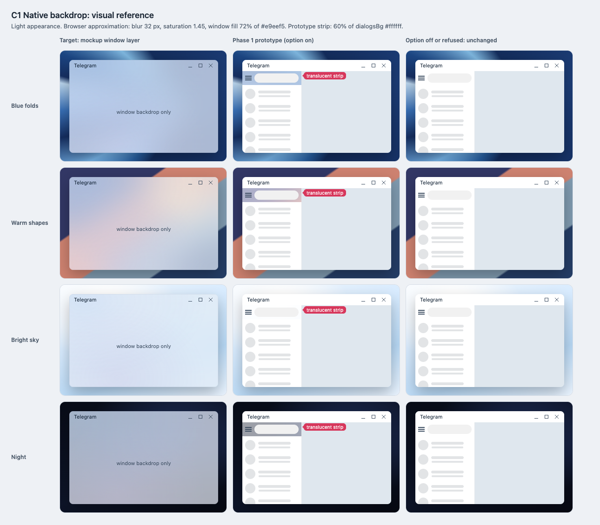
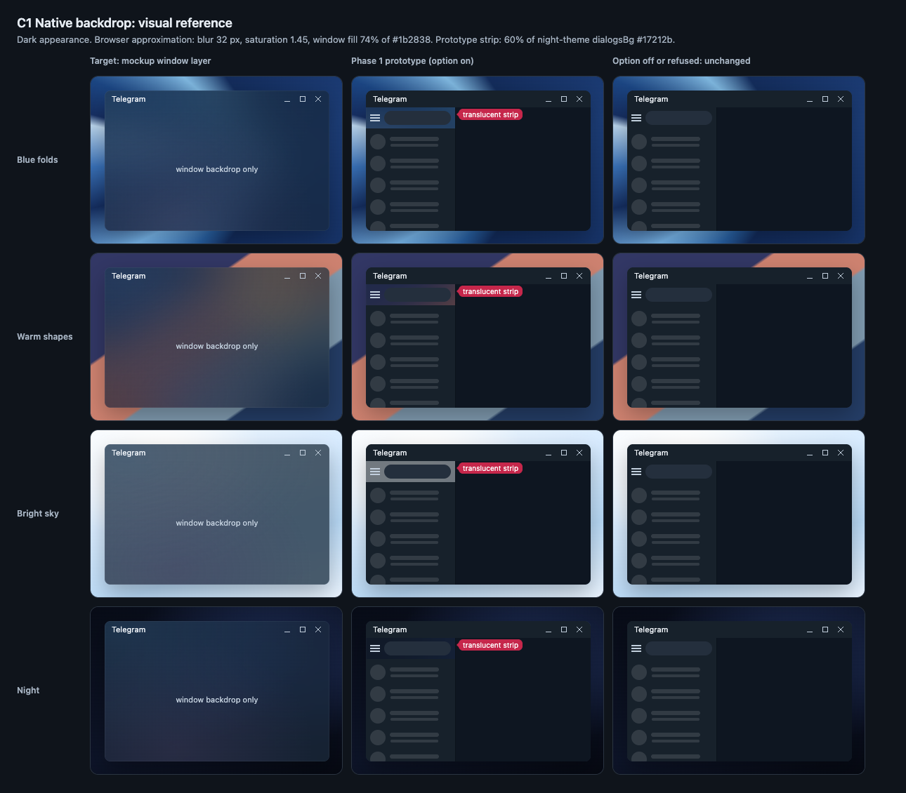

# C1 Native backdrop: visual reference

Date: 2026-10-29. Status: proposal derived from the
[readable Soft Panels mockup](../../explorations/README.md), which the user
chose as the appearance target. Component: C1 in the
[component architecture](../../architecture.md). Plan:
[native backdrop prototype](../../plans/2026-10-28-native-backdrop-prototype.md).

This reference isolates what C1 alone contributes: the desktop seen through
the window, blurred and tinted, with no panels on top. Use it for the
"Matches the mockup" row of the Phase 1 matrix, alongside the full mockup
screenshots.

## Files

- [Reference sheet](native-backdrop.html): standalone and offline. It follows
  the system appearance; `?appearance=light` or `?appearance=dark` fixes it.
- [Light screenshot](native-backdrop-light.png) and
  [dark screenshot](native-backdrop-dark.png): rendered at 100% by headless
  Chrome on macOS, so text uses the system font rather than Segoe UI.

## Columns

| Column | Shows | Source |
| --- | --- | --- |
| Target: mockup window layer | The mockup's `.app` background alone: base color at the window fill, two soft glows, blur and saturation. | `explorations/soft-panels-readable.html` |
| Phase 1 prototype (option on) | Today's layout, opaque except the strip above the chats list, painted with `PrototypeFill(st::dialogsBg)`. | Plan Task 4 |
| Option off or refused: unchanged | The same layout fully opaque. `Test-Backdrop.ps1 -Expect Opaque` must pass here. | Plan Task 5 |

Rows are the four desktop wallpapers of the mockup: Blue folds, Warm shapes,
Bright sky and Night.

## Reference values

| Value | Light | Dark | Source |
| --- | --- | --- | --- |
| Window base color | `#e9eef5` | `#1b2838` | Mockup `--base` |
| Window fill | 72% | 74% | Mockup `--win`; C3 floor for the window role |
| Glows (30% each) | `#96bff1`, `#c9bddf` | `#315c89`, `#504066` | Mockup `--glow`, `--other-glow` |
| Blur, saturation | 32 px, 1.45 | 32 px, 1.45 | Mockup `--blur`, `saturate()` |
| Prototype strip | 60% of `#ffffff` | 60% of `#17212b` | `kPrototypeFillAlpha`; `dialogsBg` in the default and night themes |

## What to look for on Windows

- **Desktop shows through.** Moving a window behind Telegram changes the
  strip and nothing else. Shapes behind are recognizable as color areas, not
  as sharp edges.
- **Tint follows the theme.** The strip is light over every wallpaper in the
  day theme and dark in night mode, as in the matching column.
- **Bright and dark wallpapers.** Over Bright sky (light) and Night (dark)
  the strip is close to the surrounding fill; that is expected, not a failure.
- **No holes.** Every area outside the strip matches the third column.

## Known differences from native rendering

- The browser blurs and saturates only; DWM Acrylic also applies its own tint,
  luminosity and noise layer, so the native strip is expected to be more
  muted than the sheet. Judge tint, blur and visibility of the desktop, not
  exact pixel values.
- The prototype strip uses 60%, thinner than the 72–74% target window fill,
  so the backdrop shows more strongly there than in the first column.
- How Acrylic looks in an inactive window is not shown. Record what Windows
  does in the matrix's "Inactive window" row.
- Placeholder bars stand in for chat rows; the conversation is a plain fill
  rather than Telegram's chat wallpaper.

## Light appearance

## Dark appearance

