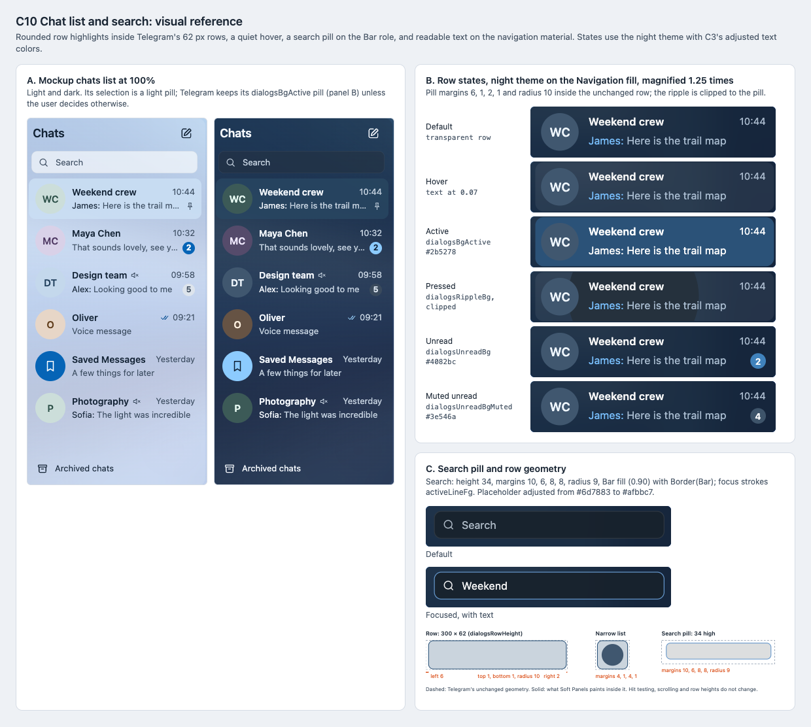

# C10 Chat list and search: visual reference

Date: 2026-10-29. Status: proposal. Component: C10 in the
[component architecture](../../architecture.md#element-styling-c9c15). Plan:
[chat list](../../plans/2026-10-29-chat-list.md).

C10 restyles the chats list on the navigation material: rounded row
highlights inside Telegram's unchanged rows, a quiet hover, a search pill,
and readable text and badges. This reference shows the mockup's list, the
row states in the night theme and the exact geometry.

## Files

- [Reference sheet](chat-list.html): standalone and offline; panel A crops
  the [C7 mockup screenshots](../c7-shell-layout/README.md).
- [Screenshot](chat-list.png): rendered at 100% by headless Chrome on macOS.

## Panels

| Panel | Plan task | What it pins |
| --- | --- | --- |
| A. Mockup list | Tasks 1–2 | Search pill, rows with avatars, unread and muted badges, archive row. |
| B. Row states | Task 1, Task 3 Step 2 | Default, hover, active, pressed with the ripple clipped to the pill, unread and muted badges. Night theme colors on the Navigation fill (0.82). Names, previews and times use C3's adjusted colors. |
| C. Search and geometry | Tasks 1–2 | Search pill default and focused; row pill margins 6, 1, 2, 1 with radius 10; narrow-list margins 4, 1, 4, 1; search pill 34 high with margins 10, 6, 8, 8 and radius 9. |

## Contrast in the night theme

Each value was computed with the [C3 script](../c3-material-fills/compute-fills.py) against
the Navigation fill (0.82 of `#17212b`) over black and white backdrops:
`#131b23` and `#414951`.

| Entry | Today | Opaque | Over black / white | Adjusted |
| --- | --- | --- | --- | --- |
| `dialogsTextFg` | `#7f91a4` | 5.03 | — | `#a8bbcf`: 8.83 / 4.65 |
| `dialogsDateFg` | `#8696a8` | 5.39 | — | `#abbbce`: 8.88 / 4.67 |
| `dialogsTextFgService` | `#73b9f5` | 7.75 | — | `#79bffc`: 8.83 / 4.65 |
| `placeholderFg` | `#6d7883` | 3.62 | — | `#afbbc7`: 8.90 / 4.68 |
| `dialogsUnreadBg` (badge shape) | `#4082bc` | 3.99 | 4.25 / 2.24 | — |
| `dialogsUnreadBgMuted` (badge shape) | `#3e546a` | 2.08 | 2.22 / 1.17 | — |

## Findings

- **`placeholderFg` is not in C3's adjusted-entry list.** The search
  placeholder is part of the Task 4 contrast row, and at 3.62:1 it misses
  4.5:1 even on the opaque surface. The plan now adds it in Task 2.
- **The badge shapes already miss 3:1.** Badge text stays readable on its own
  badge: white on `#4082bc` is 4.09:1 and on `#3e546a` is 7.83:1. The badge
  outline against the list is a different matter. The muted badge is 2.08:1
  today and falls to 1.17:1 over a white backdrop. The unread badge falls
  from 3.99:1 to 2.24:1. Task 3 Step 2 asks for exactly this check. The
  result is that both badges trigger it. The user kept today's fills
  (2026-10-31): the white count stays readable on its own badge.

## Notes

- The mockup's selection is a light pill with dark text. The user adopted it
  (2026-10-31): under Soft Panels the open chat is a `SelectedFill()` pill
  with normal text colors, which this sheet, drawn before, does not show.
- Row height (62), avatar size (46) and badge height (19) are Telegram's.
  The pill is painted inside the row, so hit testing and scrolling do not
  change.
- Day theme colors live in `lib_ui`'s default palette, which is not checked
  out here.

