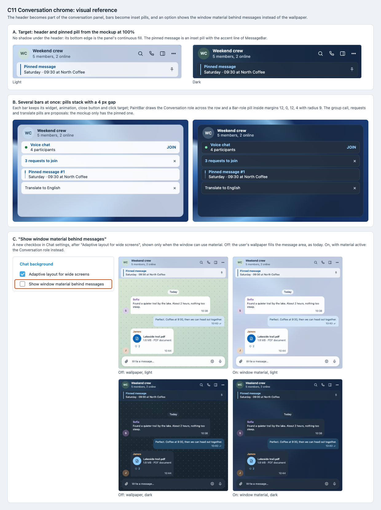

# C11 Conversation chrome: visual reference

Date: 2026-10-29. Status: proposal. Component: C11 in the
[component architecture](../../architecture.md#element-styling-c9c15). Plan:
[conversation chrome](../../plans/2026-10-29-conversation-chrome.md).

C11 merges the chat header into the conversation panel, turns the bars under
it into inset pills, and adds an option to show the window material behind
messages instead of the wallpaper. This reference shows each of the three.

## Files

- [Reference sheet](conversation-chrome.html): standalone and offline; it
  crops the [C7 mockup screenshots](../c7-shell-layout/README.md) and the two
  below.
- [Mockup with wallpaper, light](mockup-wallpaper-light.png) and
  [dark](mockup-wallpaper-dark.png): the
  [readable mockup](../../explorations/README.md) at 100% with
  `?background=pattern`.
- [Screenshot](conversation-chrome.png) of the sheet, rendered at 100% by
  headless Chrome on macOS.

## Panels

| Panel | Plan task | What it pins |
| --- | --- | --- |
| A. Header and pinned pill | Tasks 1–2 | No shadow under the header; the pinned message as an inset pill with the `MessageBar` accent line. |
| B. Bar stack | Task 2 | Group call, join requests, pinned (with the multi-message indicator) and translate bars at once: pills with margins 12, 0, 12, 4, radius 9 and a 4 px gap, no double borders. |
| C. Chat background option | Task 3 | The new checkbox after "Adaptive layout for wide screens"; with it off the wallpaper fills the message area, with it on the Conversation role does. Light and dark. |

## Notes

- The mockup has only the pinned pill. The group call, requests and
  translate pills follow the same rule and are this plan's proposal.
- The mockup's header is 56 px; Telegram keeps `topBarHeight` (54 px).
  Panel B uses 54.
- Bars use the Bar role (0.90). The mockup's pinned pill is its surface at
  72% over the conversation canvas, so its own pill looks a little lighter
  over the backdrop.
- With the option on, the bubbles, date pills and service messages keep their
  own fills. Their colors over the material are [C13](../../plans/2026-10-29-messages.md)'s
  work.
- The settings section is drawn in Telegram's current style with the day
  palette approximated; C15 restyles settings.

