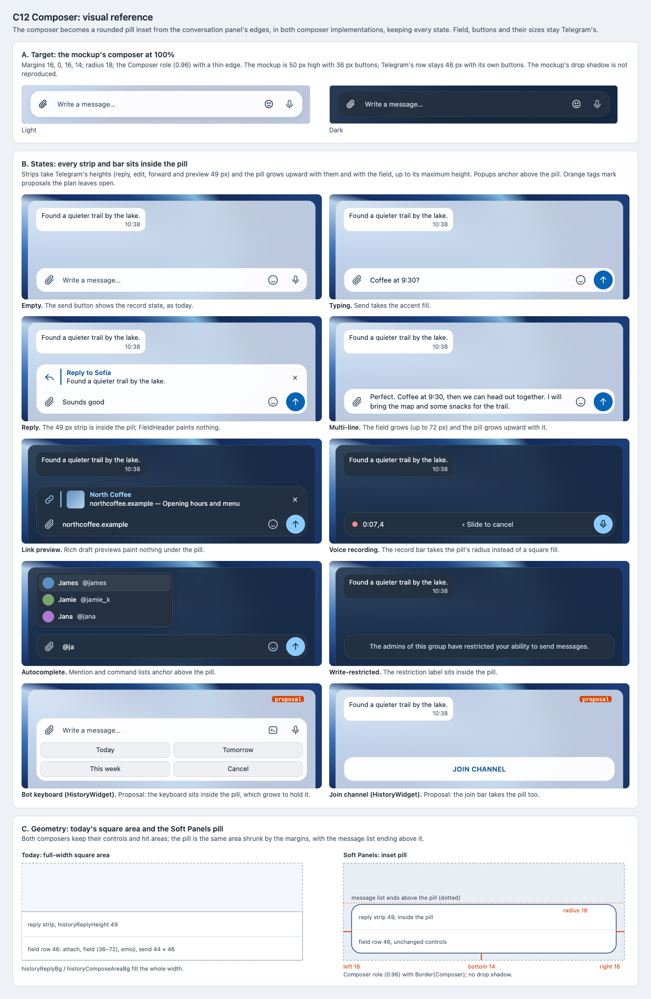

# C12 Composer: visual reference

Date: 2026-10-29. Status: proposal. Component: C12 in the
[component architecture](../../architecture.md#element-styling-c9c15). Plan:
[composer](../../plans/2026-10-29-composer.md).

C12 turns the message composer into a rounded pill inset from the
conversation panel's edges, in both `HistoryWidget` and `ComposeControls`,
keeping every composer state. This reference shows the mockup's composer,
the states the plan's checks list, and the geometry.

## Files

- [Reference sheet](composer.html): standalone and offline; panel A crops
  the [C7 mockup screenshots](../c7-shell-layout/README.md).
- [Screenshot](composer.png) of the sheet, rendered at 100% by headless
  Chrome on macOS.

## Panels

| Panel | Plan task | What it pins |
| --- | --- | --- |
| A. Mockup composer | Global Constraints | Margins 16, 0, 16, 14, radius 18, the Composer role with a thin edge, light and dark. |
| B. States | Tasks 1–3, Task 4 States row | Empty, typing, reply, multi-line, link preview, voice recording, autocomplete, write-restricted, and two proposals for `HistoryWidget`: the bot keyboard and the join channel bar inside the pill. |
| C. Geometry | Tasks 1–2 | Today's full-width area against the pill: the same controls and strip heights, the margins, and the message list ending above the pill. |

## Findings

- **`SendButton` paints no square behind itself.** Task 3 Step 1 said the
  button fills with `historyComposeAreaBg`. In `send_button.cpp` that color
  is used in two places, both in the schedule state. `historyScheduleIcon`
  draws its glyph in that color over the accent circle. `paintSchedule`
  also uses it at alpha 25 as the ripple tint. Nothing square is painted.
  The step now only checks the schedule glyph against the Composer fill.
- **`RecordBar` already has a radius.** `VoiceRecordBar::init()` turns
  `radius > 0` into a rounded background, as `ComposeControls` does, so no
  `QPainterPath` needs to be passed in. `ComposeControls` passes its style's
  `record` through `stOverride`, so the Soft Panels style can set the
  radius. `HistoryWidget` uses the constructor without a descriptor, which
  takes the default style, so it must switch to the descriptor form. Task 3
  Step 2 now says this.
- **The bot keyboard is outside the plan's pill.** `HistoryWidget` places
  `_kbScroll` under the field row, across the full width.
  `BotKeyboard::paintEvent` fills it with `historyComposeAreaBg`. Task 2
  moved only the field row, which would leave the keyboard as an opaque
  square block under the pill. The plan now puts the keyboard inside the
  pill (panel B, a proposal) and adds `bot_keyboard.cpp` to Task 2.

## Notes

- The mockup's composer is 50 px high with 36 px round buttons. Telegram
  keeps `historySendSize` (44 × 46) and its field (36 to 72 px), so the
  pill's minimum height is 46 px. Panel B uses Telegram's sizes.
- Colors are the mockup's tokens on the Composer fill (0.96). Field text,
  placeholder and strip colors are checked under C3 and Task 4.
- Whether the join channel bar takes the pill is left open by Task 2 Step 4;
  panel B draws the pill as a proposal.
- The send button's record and send icons are the mockup's. Telegram keeps
  its own icons and its state machine.

