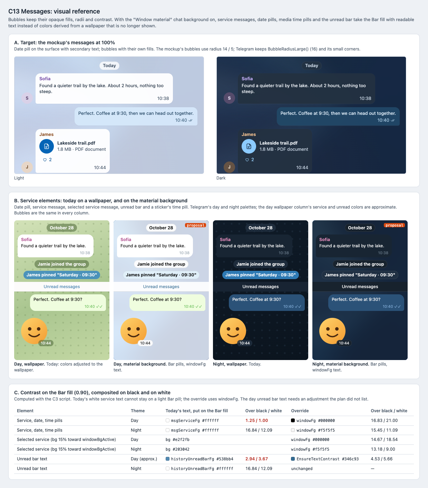

# C13 Messages: visual reference

Date: 2026-10-29. Status: proposal. Component: C13 in the
[component architecture](../../architecture.md#element-styling-c9c15). Plan:
[messages](../../plans/2026-10-29-messages.md).

C13 keeps bubbles as they are and changes the service elements when the
"Window material" chat background (C11) is on. Today, date pills, service
messages, media time pills and the unread bar use colors tuned for a
wallpaper; with the material background they take the Bar fill and readable
text. This reference shows the target, both backgrounds in day and night,
and the contrast numbers.

## Files

- [Reference sheet](messages.html): standalone and offline; panel A crops
  the [C7 mockup screenshots](../c7-shell-layout/README.md).
- [Screenshot](messages.png) of the sheet, rendered at 100% by headless
  Chrome on macOS.

## Panels

| Panel | Plan task | What it pins |
| --- | --- | --- |
| A. Mockup messages | Global Constraints | Date pill on the surface, bubbles with their own fills, light and dark. |
| B. Service elements | Task 1, Task 2 Steps 1–2 | Date pill, service message, selected service message, unread bar and a sticker's time pill. Day and night, on a wallpaper (today) and on the material background (proposal). Bubbles are the same in every column. |
| C. Contrast | Task 1 Step 2, Task 3 Contrast row | Today's text put on the Bar fill against the override, composited on black and white. |

## Findings

- **Only part of the service colors come from the wallpaper.**
  `ChatTheme` adjusts `msgServiceBg`, `msgServiceBgSelected` and the four
  history scroll bar colors to the wallpaper's average color (all marked
  "adjusted" in the theme files). `msgServiceFg` is `windowFgActive`, white
  in both default themes. The unread bar is a fixed opaque palette color.
  The plan's architecture paragraph now says so. The scroll bar colors
  would stay tinted for a hidden wallpaper, so the plan adds
  `applyScrollColors`.
- **There is no `msgServiceFgSelected`.** Selected service messages change
  only their background to `msgServiceBgSelected` and keep `msgServiceFg`.
  The selected-service setter now takes one color. The service text is
  checked over both fills: 14.67:1 or more in day and 9.00:1 or more in
  night.
- **`applyAdjustedServiceBg` does not reset the corner caches.** It only
  sets the color. That works for the background preview box, which calls it
  before anything is painted. In an open chat, the service corner pixmaps
  would keep the old color: `_serviceBgCornersNormal`,
  `_serviceBgCornersInverted` and each image style's
  `msgServiceBgCornersSmall` / `Large`. `ChatStyle::assignPalette` resets
  them. Task 1 Step 1 now resets them too and fires `paletteChanged()`.
- **`setChatStyleTheme` returns early for the same theme.** Toggling the
  material background does not change the theme, so `applyMaterialChatColors`
  calls `_chatStyle->apply()` directly.
- **The day unread bar text needs adjusting.** On the Bar fill over a black
  backdrop it drops to 2.94:1. `EnsureTextContrast` gives `#346c93`, which
  is 4.53:1 or more on both backdrops. The overrides now include
  `historyUnreadBarFg`. The day value is approximate, because `lib_ui`'s
  palette is not checked out here.

## Notes

- Today's white service text measures 1.25:1 on the day Bar pill, so the
  override switches to `windowFg` (black in day). In night, white already
  reads, and `windowFg` (`#f5f5f5`) stays above 11:1.
- The day wallpaper column approximates Telegram's default wallpaper and its
  adjusted service colors. The night column uses `night.tdesktop-theme`.
- Bubble radii stay `BubbleRadiusLarge()` (16) and the small grouped
  corners; the mockup's 14 / 5 is not applied.
- The sticker is a placeholder drawing.

