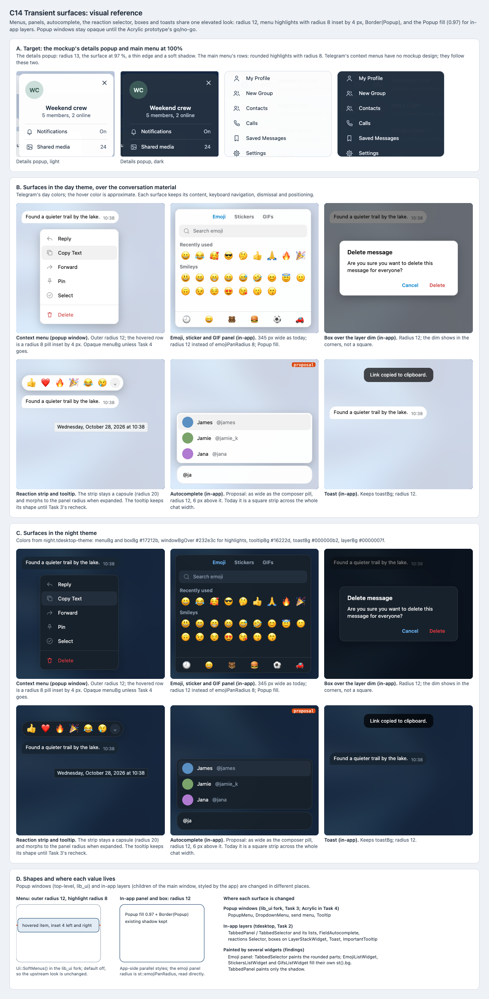

# C14 Transient surfaces: visual reference

Date: 2026-10-29. Status: proposal. Component: C14 in the
[component architecture](../../architecture.md#components). Plan:
[transient surfaces](../../plans/2026-10-29-transient-surfaces.md).

C14 gives menus, panels, autocomplete, the reaction selector, boxes and
toasts one elevated look. In-app layers take the Popup fill (0.97) and radius
12. Context menus take radius 12 with rounded highlights in the `lib_ui`
fork, and stay opaque unless the popup Acrylic prototype goes. This
reference shows the mockup's targets, each surface in day and night, and
where each one is changed.

## Files

- [Reference sheet](transient-surfaces.html): standalone and offline. It
  crops the two captures below and the
  [C9 main menu captures](../c9-navigation-rail/README.md).
- [Mockup with details, light](mockup-details-light.png) and
  [dark](mockup-details-dark.png): the
  [readable mockup](../../explorations/README.md) at 100% with its chat
  details popup open. They were captured from a scratch copy that clicks the
  details button on load.
- [Screenshot](transient-surfaces.png) of the sheet, rendered at 100% by
  headless Chrome on macOS.

## Panels

| Panel | Plan task | What it pins |
| --- | --- | --- |
| A. Mockup targets | Global Constraints | The details popup (radius 13, 97 % surface, thin edge, soft shadow) and the main menu's radius 8 rows, light and dark. |
| B. Day theme | Tasks 2–3, Task 5 States row | Context menu with a hovered row, emoji panel, box over the layer dim, reaction strip with a tooltip, autocomplete above the composer, toast. |
| C. Night theme | Tasks 2–3 | The same surfaces with `night.tdesktop-theme` colors. |
| D. Shapes and ownership | Tasks 2–3 | Outer radius 12 and highlight radius 8 inset by 4 px; which surfaces change in the `lib_ui` fork and which in tdesktop; the emoji panel's paint sites. |

## Findings

- **`TabbedPanel` does not paint the emoji panel's background.** Its
  `paintEvent` paints only the shadow, or the show animation from a cached
  grab. `TabbedSelector` paints the rounded top or bottom part from corner
  pixmaps. Each list (`EmojiListWidget`, `StickersListWidget`,
  `GifsListWidget`) fills `st().bg` itself. Task 2 Step 2 now names these
  sites. Under Soft Panels the lists paint nothing, so that one rounded
  translucent shape is painted once and not stacked.
- **The emoji panel's radius is not a style field.** `st::emojiPanRadius`
  (8 px, in `chat_helpers.style`) is read directly in 40 places across 11
  files. A parallel style object cannot change it. Task 2 now adds
  `Ui::PopupPanelRadius()` and replaces the 36 uses in transient surfaces.
  The reaction selector is one of them: its strip morphs into the panel
  radius when it expands.
- **Autocomplete is a square across the whole chat width.**
  `FieldAutocomplete::paintEvent` fills `rect()` with `_st.bg`, inside
  bounds the width of the chat area. Under Soft Panels the plan now limits
  it to the composer pill's width and rounds it. The 6 px gap is a
  proposal. The [C12 sheet](../c12-composer/README.md) drew the list too
  narrow; it now spans the pill's width too.
- **The reaction selector paints into opaque buffers.** `_paintBuffer` is
  filled with `_st.bg` and the round-frame cache uses `_st.bg` as its
  background, so a translucent fill needs both to start transparent. Task 2
  Step 2 now says so.

## Notes

- Context menus have no mockup design. They follow the details popup's
  shape and the main menu's rows. The 4 px highlight inset is the plan's
  value.
- Day colors approximate `lib_ui`'s default palette, which is not checked out
  here: `windowBgOver` and the subtext and icon grays. Night colors come
  from `night.tdesktop-theme`. That file sets `menuBgOver` to `#ffffff`, so
  the night hover uses `windowBgOver` (`#232e3c`); recheck which one
  `PopupMenu` reads at the pinned `lib_ui` commit.
- The toast keeps `toastBg` (black at 70 %) and is not given the Popup fill.
  The tooltip keeps its shape until Task 3's recheck.
- The emoji panel keeps `emojiPanWidth` (345 px) and its tabs, search and
  footer.

