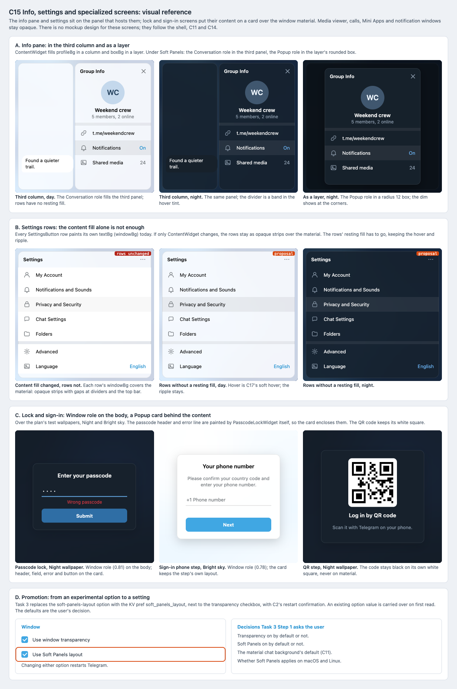

# C15 Info, settings and specialized screens: visual reference

Date: 2026-10-30. Status: proposal. Component: C15 in the
[component architecture](../../architecture.md#components). Plan:
[info, settings and specialized screens](../../plans/2026-10-29-info-settings.md).

C15 brings the info pane, settings, lock and sign-in screens into Soft
Panels, then promotes the experimental switch to a setting. The mockup has no
design for these screens, so this reference follows the shell (C7), the
conversation chrome (C11) and the transient surfaces (C14).

## Files

- [Reference sheet](info-settings.html): standalone and offline.
- [Screenshot](info-settings.png) of the sheet, rendered at 100% by headless
  Chrome on macOS.

## Panels

| Panel | Plan task | What it pins |
| --- | --- | --- |
| A. Info pane | Task 1 Step 1 | Third column in day and night (Conversation role), and as a layer (Popup role in a radius 12 box over the dim). |
| B. Settings rows | Task 1 Step 2 | Rows that keep their `windowBg` fill against rows without a resting fill; hover and ripple stay. |
| C. Lock and sign-in | Task 2 | Passcode lock and the QR step over the Night wallpaper, the phone step over Bright sky. The Window role is on the body, with a Popup card behind the content. The QR code keeps its white square. |
| D. Promotion | Task 3 | "Use Soft Panels layout" next to "Use window transparency", and the four default decisions the plan asks the user. |

## Findings

- **Settings rows paint their own background.** Every row is a
  `Ui::SettingsButton`. The app's `settingsButton` and `infoProfileButton`
  derive from `lib_ui`'s `defaultSettingsButton` and are used in 53 files.
  Each row fills its `textBg` (`windowBg`) under itself; `settingsOptionDisabled`
  relies on this to turn off hover with `textBg: windowBg`. Changing
  `ContentWidget`'s fill alone leaves opaque strips (panel B, left).
  The [C17 shared controls plan](../../plans/2026-10-30-shared-controls.md)
  maps this fill for every control at once: a surface-colored fill is
  skipped, and the `windowBgOver` hover and divider band become the soft hover
  of the chats list. C15 consumes it instead of adding its own flag. The paint
  function, `SettingsButton::paintBg`, was read at the pinned commit
  `79c846fd`.
- **The lock screen fill is in `paintContent`.** `LockWidget::paintEvent`
  delegates to `LockWidget::paintContent`, which fills `windowBg`.
  `PasscodeLockWidget::paintContent` then draws the "Enter passcode" header
  and the error line directly, outside any child widget. The card must
  enclose them. Task 2 Step 1 now says so.

## Confirmed in the source

- `ContentWidget` sets `WA_OpaquePaintEvent` and picks `boxBg` for a layer
  and `profileBg` otherwise. `TopBar` is opaque only without `_roundRect`.
- `settings_intro.cpp` sets `WA_OpaquePaintEvent` on its wrap.
- `Intro::Widget::paintEvent` fills `windowBg` behind the steps.
- The QR step builds its image on white and paints a white rounded
  background (`intro_qr.cpp`), so it never shows material.

## Notes

- Colors are Telegram's day and night palettes. The day hover and divider
  colors are approximate (`lib_ui`'s palette is not checked out). The two
  test wallpapers are the mockup's Night and Bright sky.
- Dividers keep a band in the soft hover tint (C17), lighter than the panel
  in both themes, as `windowBgOver` is today.
- The passcode, phone and QR texts are shortened stand-ins for the real
  language strings.

