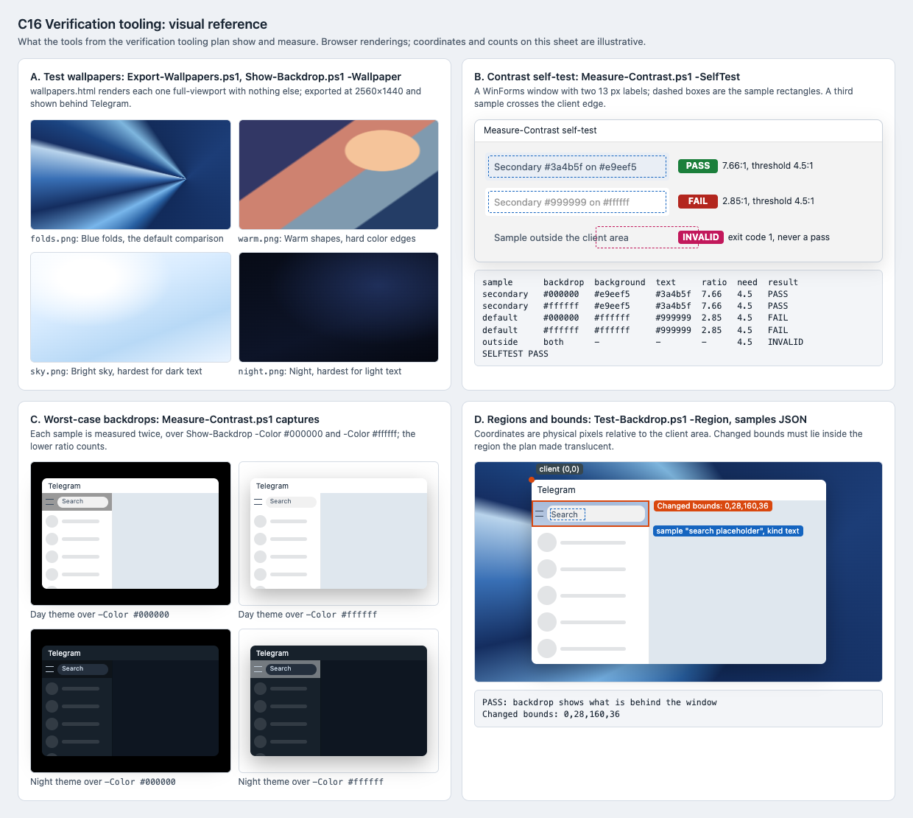

# C16 Verification tooling: visual reference

Date: 2026-10-29. Status: proposal. Component: C16 in the
[component architecture](../../architecture.md). Plan:
[verification tooling](../../plans/2026-10-29-verification-tooling.md).

C16 changes nothing in Telegram's appearance. This reference shows what its
tools put on screen and what their results look like, so an implementer can
tell a working script from a broken one before any element plan relies on it.

## Files

- [Reference sheet](verification-tooling.html): standalone and offline.
- [Screenshot](verification-tooling.png): rendered at 100% by headless Chrome
  on macOS, so text uses the system font rather than Segoe UI.

## Panels

| Panel | Plan task | What it pins |
| --- | --- | --- |
| A. Test wallpapers | Task 1 | The four images `Export-Wallpapers.ps1` writes, with the CSS copied from the [readable mockup](../../explorations/README.md). Step 2's "matches by eye" compares against these tiles. |
| B. Contrast self-test | Task 2 | The `-SelfTest` window: `#3a4b5f` on `#e9eef5` passes at 7.66:1, `#999999` on `#ffffff` fails at 2.85:1, and a sample crossing the client edge is `INVALID` with exit code 1. |
| C. Worst-case backdrops | Task 2 | The two captures per sample, over `-Color #000000` and `-Color #ffffff`, for the day and night themes. The translucent strip changes between them; opaque areas do not. |
| D. Regions and bounds | Tasks 2–3 | Coordinates start at the client area's top-left, which includes Telegram's own title bar. `Changed bounds` from `Test-Backdrop.ps1` must sit inside the region the plan made translucent; a sample rectangle wraps the text it measures. |

The two self-test ratios were recomputed with the WCAG 2.2 relative luminance
formula for this reference: 7.66 and 2.85, matching the plan.

## Illustrative parts

- Panel B's output table shows one possible layout of the report. The plan
  fixes its columns (background, text, ratio, threshold, result per sample and
  backdrop), not their spacing.
- Panel D's coordinates belong to the drawing, not to a real Telegram window.
- Compare-Captures has no picture; its contract is three exit codes: 0 for no
  difference above the tolerance, 1 for a difference, 2 for mismatched sizes.

