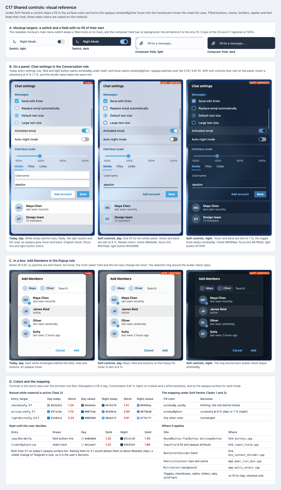

# C17 Shared controls: visual reference

Date: 2026-10-30. Status: proposal. Component: C17 in the
[component architecture](../../architecture.md#components). Plan:
[shared controls](../../plans/2026-10-30-shared-controls.md). Grouping:
[shared elements](../../shared-elements.md#c17-shared-controls).

C17 lets buttons, fields, settings rows and list rows rest on the role fill
of their panel or box. Under Soft Panels, a fill in the surface color
(`windowBg`, `boxBg`) is skipped, and the opaque `windowBgOver` hover and
divider band become `windowFg` at 6 % (day) or 7 % (night), the hover of the
chats list and rail. Three state colors are raised on the material. The
mockup has only a switch and a field; the rest follows C9, C10 and C15.

## Files

- [Reference sheet](shared-controls.html): standalone and offline. It crops
  the [C9 main menu captures](../c9-navigation-rail/README.md) and the
  [C7 mockup captures](../c7-shell-layout/README.md).
- [Screenshot](shared-controls.png) of the sheet, rendered at 100% by
  headless Chrome on macOS.

## Panels

| Panel | Plan task | What it pins |
| --- | --- | --- |
| A. Mockup targets | Global Constraints | The main menu switch with its filled knob, and the composer field with no background of its own, light and dark. |
| B. On a panel | Tasks 1 and 3 | Chat settings in the Conversation role: today's patches (rows, fields, light button, list rows, grey hover and band) against soft controls, day and night, with the raised colors. |
| C. In a box | Tasks 1 and 2 | Add Members in the Popup role: the multi-select field, peer list rows with selection checks, hover and light buttons. |
| D. Colors and the mapping | Tasks 1–3 | The three raised entries with their worst contrast before and after, the two entries kept for a decision, the mapping and where it applies. |

## Findings

- **One rule covers most controls.** `RoundButton` (rounded `textBg`),
  `FlatButton` (`bgColor`), `SettingsButton` (`textBg`), `InputField`
  (`textBg`) and `BoxContentDivider` (`bg`) all paint a color that is the
  surface color, or `windowBgOver`, in the default themes. Mapping those two
  kinds of color covers them. Every other fill keeps its look, including
  filled buttons and error states, because their colors differ.
- **`InputField` declares itself opaque.** Its constructor sets
  `WA_OpaquePaintEvent` when `textBg` is opaque and the field has no radius.
  Skipping the fill alone would leave stale pixels on the material, so Task 1
  drops the attribute when the fill maps to nothing.
- **Hover was the inconsistent part.** Settings rows and peer list rows hover
  with opaque `windowBgOver`, while C9 and C10 hover with translucent text.
  The mapping gives them the same hover. In solid mode, the soft hover over
  white is `#f0f0f0` against `windowBgOver` `#f1f1f1`.
- **C15's settings row flag is no longer needed.** `SettingsButton` is one of
  the mapped sites, so C15 now uses C17's switch instead of adding
  `SetTransparentSettingsRows`.
- **Peer lists are app code.** `PeerListContent` fills the area below its
  rows and each row, and clears status icon areas in cached row images, with
  `defaultPeerListButton.textBg` (`windowBg`). Task 2 maps all three.
- **State colors fail on the material.** Unchecked marks, the focused field
  line and light button text drop to 1.24, 1.70 and 2.24:1 in the day theme
  over the Navigation floor (panel D). Themes store `lightButtonFg` separately
  from `windowActiveTextFg`, so C3's existing entry does not raise it.
- **The folder tabs strip needs nothing.** `chat_filters_tabs_strip.cpp`
  paints ripples and an accent bar only, so it already shows the panel fill.
  Task 4 checks it.

## Notes

- Colors are `lib_ui`'s day palette at the pinned commit `79c846fd`, read from
  `github.com/desktop-app/lib_ui`, and `night.tdesktop-theme`. Secondary and
  section text use C3's adjusted values (`#535353` / `#a6bcd2`, `#005888` /
  `#79c0ff`).
- Raised values come from C3's `compute-fills.py`, against the lowest floor
  of the roles Navigation, Conversation and Popup.
- The sheet draws toggles, checkboxes, radios and sliders in the shape
  Telegram uses, simplified; C17 changes none of these shapes.
- The filled Save button is drawn 28 px high with radius 4, at the user's
  request. Radius 4 is Telegram's `buttonRadius`. The user then kept
  Telegram's 34 px `defaultActiveButton` height for the app (2026-10-31).
- Field lines and slider tracks keep their colors, and text fields keep their
  bottom line, as the user decided (2026-10-31).

