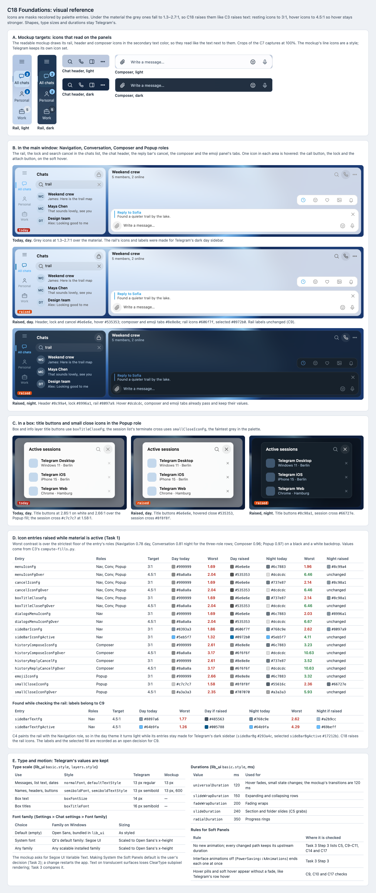

# C18 Foundations: visual reference

Date: 2026-10-31. Status: proposal. Component: C18 in the
[component architecture](../../architecture.md#components). Plan:
[foundations](../../plans/2026-10-31-foundations.md). Grouping:
[shared elements](../../shared-elements.md#c18-foundations).

C18 keeps Telegram's type scale, icon shapes and durations, and changes only
what fails on the material: the grey icon colors. While material is active,
resting icon entries are raised to 3:1 and hover entries to 4.5:1, the way C3
raises secondary text. The user chose the system font as the Soft Panels
default, and motion is only checked.

## Files

- [Reference sheet](foundations.html): standalone and offline. It crops the
  [C7 mockup captures](../c7-shell-layout/README.md).
- [Screenshot](foundations.png) of the sheet, rendered at 100% by headless
  Chrome on macOS.

## Panels

| Panel | Plan task | What it pins |
| --- | --- | --- |
| A. Mockup targets | Global Constraints | The mockup's rail, chat header and composer icons, light and dark, drawn in the secondary text color. |
| B. In the main window | Tasks 1 and 3 | The rail, the chats list lock and search cancel, the chat header, the reply bar's cancel, the composer and the emoji panel's tabs on their roles: today, raised day and raised night, with one hovered icon per area. |
| C. In a box | Tasks 1 and 3 | Box title buttons and the session list's small cross in the Popup role, in the same three states. |
| D. Icon entries | Task 1 | Every raised entry with its roles, target and worst contrast before and after, day and night, and the rail label entries left to C9. |
| E. Type and motion | Tasks 2 and 3 | Telegram's type scale against the mockup's, the font family choices, the `lib_ui` durations and the motion rules. |

## Findings

- **Most icons already read.** Of 2,110 icon definitions in the app's
  `.style` files, 301 use `menuIconColor` and 26 `infoIconFg`, both
  `windowBoldFg` (`#222222`). Grey ones are `menuIconFg` (41) and
  `menuIconFgOver` (23), `boxTitleCloseFg` and its hover (40 each),
  `sideBarIconFg` (48), `sideBarIconFgActive` (38) and `historyComposeIconFg`
  (22). These are what C18 raises.
- **Grey icons fail even on white.** `menuIconFg` `#999999` is 2.85:1 on
  `windowBg`, below 3:1 in solid mode. Over the strictest Navigation floor it
  drops to 1.69:1; `smallCloseIconFg` `#c7c7c7` drops to 1.58:1.
- **Hover needs its own target.** With both at 3:1, `#999999` and its hover
  `#8a8a8a` become the same `#6e6e6e`, and the icon stops changing on hover.
  At 4.5:1 the hover becomes `#535353`, still darker than rest. In night, every
  hover entry (`#dcdcdc`) already passes and is unchanged.
- **Night composer and emoji icons already pass.** Over the 0.96 Composer and
  0.97 Popup fills, `#6c7883` reaches 3.23 and 3.32:1, so only the day theme
  changes there.
- **The rail was made for a dark sidebar.** In the day theme `sideBarBg` is
  `#293a4c`, with labels `#8897a6` and a selected fill `sideBarBgActive`
  `#17212b`. C4 paints the rail with the Navigation role, so with material
  active it turns light while those entries stay. C18 raises the icons. The
  labels would need `#485563` and `#005788` for 4.5:1, and the near-black
  selected fill does not suit a light rail. The user chose a light rail
  (2026-10-31): C9 gives it the chats list's colors and the shared selected
  pill.
- **Fonts are sized to match already.** `ResolveFont` in `lib_ui`'s
  `style_core_font.cpp` uses bundled Open Sans for Default, and Qt's default
  family (Segoe UI on Windows) for System. It scales a System or custom
  family's pixel size so its x-height matches Open Sans. Switching the default
  needs no size changes, only a decision.

## Notes

- Colors are `lib_ui`'s day palette at the pinned commit `79c846fd`, read from
  `github.com/desktop-app/lib_ui`, and `night.tdesktop-theme`. Secondary text
  uses C3's adjusted values (`#535353` / `#a6bcd2`).
- Raised values come from C3's `compute-fills.py` functions, against the
  lowest floor of each entry's roles, on a black and a white backdrop.
- Icons are the approved mockup's line icons, as stand-ins. Telegram keeps its
  own icon shapes; only their colors change.
- Neither Open Sans nor Segoe UI is installed where the sheet was rendered, so
  panel E shows the type scale as a table. Task 2 Step 1 takes the real
  Windows screenshots the font decision needs.
- The sheet's font is the mockup's stack, which falls back to the system font
  on macOS.

