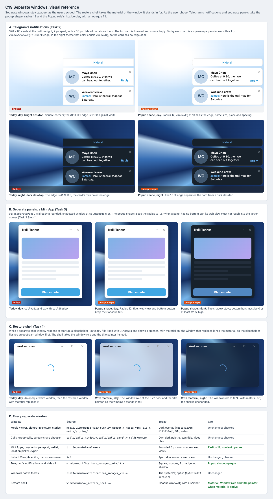

# C19 Separate windows: visual reference

Date: 2026-10-31. Status: proposal. Component: C19 in the
[component architecture](../../architecture.md#components). Plan:
[separate windows](../../plans/2026-10-31-separate-windows.md). Grouping:
[shared elements](../../shared-elements.md#c19-separate-windows).

Separate windows stay opaque, as the user decided. C19 changes only the
restore shell, which stands in for a main window, and, as the user chose
(2026-10-31), gives Telegram's notifications and separate panels the popup
shape: radius 12 and the Popup role's 1 px border, with opaque fills.
Everything else is checked to be unchanged.

## Files

- [Reference sheet](separate-windows.html): standalone and offline.
- [Screenshot](separate-windows.png) of the sheet, rendered at 100% by
  headless Chrome on macOS.

## Panels

| Panel | Plan task | What it pins |
| --- | --- | --- |
| A. Telegram's notifications | Task 2 | A Hide all bar and two notifications, one hovered with Reply, today and in the popup shape, day over a bright desktop and night over a dark one. |
| B. Separate panels | Task 3 | A Mini App panel at today's 6 px radius and at 12, day and night, with title, web view and bottom button opaque. |
| C. Restore shell | Task 1 | Today's white placeholder against the shell with the Window role and title, day and night. |
| D. Every separate window | Tasks 1–4 | Each separate window, its source, how it looks today and what C19 does with it. |

## Findings

- **Night notifications have no edge.** `Notification::updateNotifyDisplay`
  draws a 1 px `notifyBorder` (`windowShadowFgFallback`) into each card's
  cache. In the night theme that color is `#17212b`, the same as
  `notificationBg`, so a card has no edge on a dark desktop. In the day theme
  the `#f1f1f1` edge is 1.13:1 against the white card. The popup shape's
  border (`windowFg` at 10 %) fixes both.
- **Notifications are opaque tool windows with no shadow.** `Widget::Widget`
  sets `Qt::NoDropShadowWindowHint` and `Qt::WA_OpaquePaintEvent`, and fades
  with `setWindowOpacity`. Rounding them needs a translucent window, so the
  fade has to be checked for corner artifacts.
- **Separate panels are already rounded.** `Ui::SeparatePanel` is a
  translucent window that paints its own `callShadow` and rounds its frame
  with `callRadius` (6 px), read directly in five places. A 12 px radius
  needs one fork hook. `setBottomBarHeight` requires a bottom bar of 0 or at
  least the radius, so callers have to be rechecked.
- **The restore shell is the one separate window that should change.** It is
  a placeholder `RpWindow` filled with `windowBg`, shown while a separate chat
  window reopens at startup. With material on, the window that replaces it
  has the material, so today the user sees an upstream window first.
- **Native toasts are opt-in on Windows.** `Platform::Notifications::
  ByDefault()` is `false` in `notifications_manager_win.cpp`, so Telegram's
  own notifications are what most Windows users see.

## Notes

- Colors are `lib_ui`'s day palette at the pinned commit `79c846fd`, read from
  `github.com/desktop-app/lib_ui`, and `night.tdesktop-theme`. Notification
  sizes are `window/window.style` values: `notifyWidth` 320, `notifyMinHeight`
  80, `notifyPhotoSize` 62, `notifyDeltaY` 7, `notifyHideAllHeight` 36.
- The Mini App content is a placeholder; real web views keep whatever the bot
  draws.
- The restore shell's material is drawn with the mockup's blur over the test
  wallpaper, at the Window role floors (0.72 / 0.74).
- Media viewer, calls and Instant View are not drawn: C19 changes nothing in
  them, and Task 4 checks them against screenshots.

