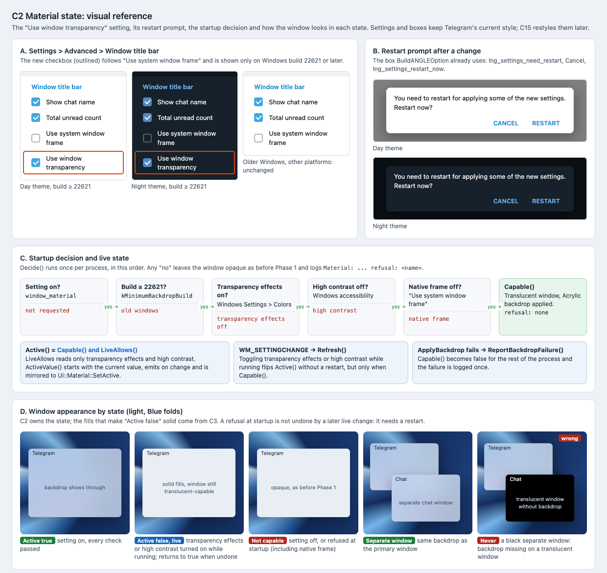

# C2 Material state: visual reference

Date: 2026-10-29. Status: proposal. Component: C2 in the
[component architecture](../../architecture.md#material-state-c2). Plan:
[material state](../../plans/2026-10-29-material-state.md).

C2 adds the "Use window transparency" setting and the state that decides
whether the window shows the backdrop. This reference shows the setting, its
restart prompt, the decision order and the window in each state.

## Files

- [Reference sheet](material-state.html): standalone and offline.
- [Screenshot](material-state.png): rendered at 100% by headless Chrome on
  macOS, so text uses the system font rather than Segoe UI.

## Panels

| Panel | Plan task | What it pins |
| --- | --- | --- |
| A. Settings | Task 2 Steps 4–6 | "Use window transparency" directly below "Use system window frame" under "Window title bar", in the day and night themes. On builds below 22621 and on other platforms the row is absent and the section is unchanged. |
| B. Restart prompt | Task 2 Step 5 | The existing box: "You need to restart for applying some of the new settings. Restart now?" with Cancel and Restart. |
| C. Decision and live state | Tasks 1 and 3 | The `Decide()` order and the refusal name each step logs; `Active()` as `Capable()` and `LiveAllows()`; what `Refresh()` and `ReportBackdropFailure()` change. |
| D. Window by state | Task 4 | Active, live fallback, not capable, and the separate chat window. A black separate window is the failure the plan's Review Focus names. |

The phrases in panels A and B come from `lang.strings`, except the new
`lng_settings_window_material`. "Show active account" appears only with more
than one account and is left out.

## Notes

- Settings and boxes keep Telegram's current style. Night colors are from
  `night.tdesktop-theme`; day colors approximate the default palette in
  `lib_ui`, which is not checked out here.
- "Active false, live" and "Not capable" look alike on screen. The
  difference is that only the first returns to the backdrop without a
  restart. The solid fills come from C3, not from C2.
- The window drawings reuse the target layer from the
  [C1 reference](../c1-native-backdrop/README.md).

