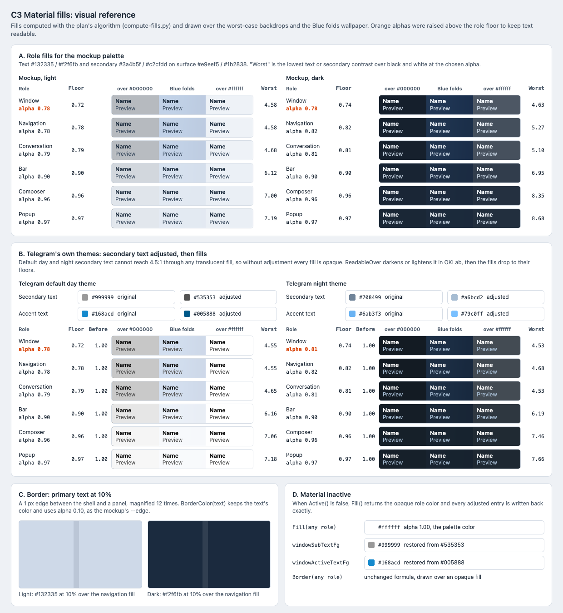

# C3 Material fills: visual reference

Date: 2026-10-29. Status: proposal. Component: C3 in the
[component architecture](../../architecture.md#material-fills-c3). Plan:
[material fills](../../plans/2026-10-29-material-fills.md).

C3 picks a translucent fill per surface role and adjusts secondary and accent
text so it stays readable over any backdrop. This reference shows the
computed fills over the worst-case backdrops and a real wallpaper, for the
mockup palette and for Telegram's default day and night themes.

## Files

- [Reference sheet](material-fills.html): standalone and offline.
- [Screenshot](material-fills.png): rendered at 100% by headless Chrome on
  macOS, so text uses the system font rather than Segoe UI.
- [compute-fills.py](compute-fills.py): reproduces `ComputeFill` (Task 1) and
  `ReadableOver` (Task 2) and prints the numbers on the sheet. Run it with
  `python3 -I compute-fills.py`.

## Computed values

Alpha per role. **Bold** values were raised above the role floor.

| Role | Floor (light / dark) | Mockup light | Mockup dark | Telegram day | Telegram night |
| --- | --- | --- | --- | --- | --- |
| Window | 0.72 / 0.74 | **0.78** | **0.78** | **0.78** | **0.81** |
| Navigation | 0.78 / 0.82 | 0.78 | 0.82 | 0.78 | 0.82 |
| Conversation | 0.79 / 0.81 | 0.79 | 0.81 | 0.79 | 0.81 |
| Bar | 0.90 / 0.90 | 0.90 | 0.90 | 0.90 | 0.90 |
| Composer | 0.96 / 0.96 | 0.96 | 0.96 | 0.96 | 0.96 |
| Popup | 0.97 / 0.97 | 0.97 | 0.97 | 0.97 | 0.97 |

Text adjusted by `ReadableOver` against the Navigation and Conversation
floors over black and white:

| Theme | Secondary | Accent |
| --- | --- | --- |
| Mockup light / dark | unchanged | unchanged |
| Telegram day | `#999999` → `#535353` | `#168acd` → `#005888` |
| Telegram night | `#708499` → `#a6bcd2` | `#6ab3f3` → `#79c0ff` |

Before adjustment, every fill in both Telegram themes is 1.00: their
secondary text is below 4.5:1 even on the opaque surface, so no translucent
fill can keep it. Adjusting first, as plan Task 3 does, lets the fills drop to
their floors.

These values match the plan's unit tests: mockup light Navigation 0.78,
mockup light Window raised to 0.78, mockup dark Navigation 0.82, and the
default theme at 1.00 before adjustment.

## Panels

| Panel | Plan task | What it pins |
| --- | --- | --- |
| A. Mockup palette | Task 1 | The alpha per role, each fill over `#000000`, Blue folds and `#ffffff`, and the lowest contrast reached. |
| B. Telegram themes | Tasks 2–3 | Original and adjusted secondary and accent colors, the fills before and after the adjustment. |
| C. Border | Task 1 | `BorderColor(text)`: text color at 10% on a 1 px edge, magnified. |
| D. Material inactive | Task 3 Step 4 | Opaque fills and the exact original colors written back. |

## Notes

- The script skips the olive hue nudge of `EnsureContrast`; it only changes
  yellow hues, and none of these colors is yellow.
- `Composite` rounds each channel, as `chat_theme_readability.cpp` does. A
  native implementation that keeps more precision may differ by 0.01 in
  alpha.
- Night colors come from `night.tdesktop-theme`. Day colors
  (`windowFg #000000`, `windowSubTextFg #999999`,
  `windowActiveTextFg #168acd`) approximate the default palette in `lib_ui`,
  which is not checked out here. Recheck them at the pinned commit.
- The Night theme Window role is raised to 0.81, a case the plan's unit tests
  do not cover. Use it as an extra expectation when checking Task 3.

