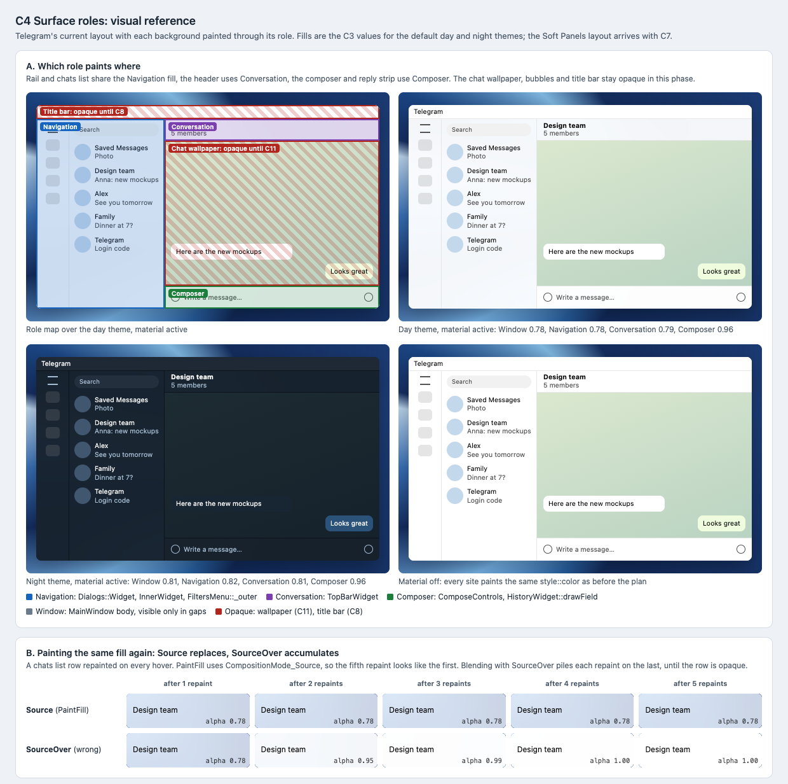

# C4 Surface roles: visual reference

Date: 2026-10-29. Status: proposal. Component: C4 in the
[component architecture](../../architecture.md#surface-roles-c4). Plan:
[surface roles](../../plans/2026-10-29-surface-roles.md).

C4 routes each background in the main window through its surface role. This
reference shows which role paints each region of Telegram's current layout,
how the window looks with the C3 fills, and why fills replace rather than
blend.

## Files

- [Reference sheet](surface-roles.html): standalone and offline.
- [Screenshot](surface-roles.png): rendered at 100% by headless Chrome on
  macOS, so text uses the system font rather than Segoe UI.

## Panels

| Panel | Plan task | What it pins |
| --- | --- | --- |
| A. Role map | Tasks 2–4 | The rail and chats list share Navigation; the header is Conversation; the composer and reply strip are Composer; the Window role shows only in gaps. The wallpaper (C11) and title bar (C8) stay opaque. Day and night with material active, and material off. |
| B. Source versus SourceOver | Task 1, Task 3 Step 5 | The same 0.78 fill repainted five times: `PaintFill` stays at 0.78, while blending reaches 0.95, 0.99 and then opaque. This is the "no darkened rows on hover" check. |

## Paint sites

| Region | Site | Role | Solid color with material off |
| --- | --- | --- | --- |
| Main window body | `MainWindow` body paint request | Window | `windowBg` |
| Above, between and below the chats scroll | `Dialogs::Widget::paintEvent` | Navigation | `dialogsBg` |
| Chats list | `Dialogs::InnerWidget::paintEvent` | Navigation | `dialogsBg` |
| Folder rail | `FiltersMenu::_outer` | Navigation | `windowFiltersButton.textBg` |
| Folder slide canvas | `Widget::startChatsFilterSlide` | Navigation | `dialogsBg` |
| Chat header | `TopBarWidget::paintEvent` | Conversation | `topBarBg` |
| Composer (threads) | `ComposeControls` paint request | Composer | `historyComposeAreaBg` |
| Reply strip (chats) | `HistoryWidget::drawField` | Composer | `historyReplyBg` |

## Notes

- The fills are the C3 values for Telegram's own themes from the
  [C3 reference](../c3-material-fills/README.md). Over a blue wallpaper, white at
  0.78 is a light tint, so the day tile differs from the material-off tile
  mainly in the rail, the list and the header.
- Row hover and selection keep today's colors; C10 restyles them. In this
  phase they must only stop accumulating.
- The chat wallpaper and bubbles are placeholders for Telegram's default
  pattern and colors.

