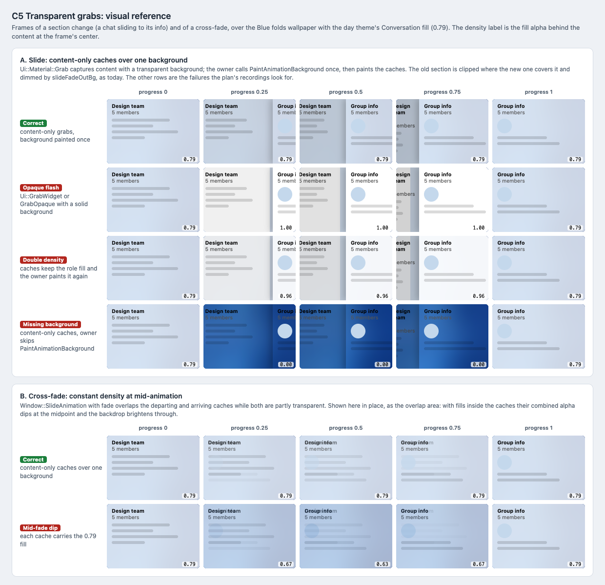

# C5 Transparent grabs: visual reference

Date: 2026-10-29. Status: proposal. Component: C5 in the
[component architecture](../../architecture.md#grabs-c5). Plan:
[transparent grabs](../../plans/2026-10-29-transparent-grabs.md).

C5 keeps animations from showing opaque, doubled or missing backgrounds
over the material. This reference shows animation frames as the plan's
screen recordings should look, next to the failures they must not show.

## Files

- [Reference sheet](transparent-grabs.html): standalone and offline.
- [Screenshot](transparent-grabs.png): rendered at 100% by headless Chrome on
  macOS, so text uses the system font rather than Segoe UI.

## Panels

| Panel | Plan task | What it pins |
| --- | --- | --- |
| A. Slide | Tasks 1–2 | A chat sliding to its info at progress 0, 0.25, 0.5, 0.75 and 1. Correct: density stays 0.79. Failures: an opaque flash (1.00) from solid grabs, double density (0.96) from caches that keep the fill, and bare backdrop (0.00) when the owner skips `PaintAnimationBackground`. |
| B. Cross-fade | Task 2 Step 4 | Where a fading slide overlaps both caches. Correct: 0.79 throughout. With the fill inside each cache, the combined alpha dips to 0.63 at the midpoint. |

The density values are computed, not measured: 0.96 is 0.79 over 0.79, and
the cross-fade dip is the old cache at `1 - p` under the new one at `p`.

## How the frames follow today's animation

`Window::SlideAnimation::paintContents` in `window_slide_animation.cpp` was
read for this reference:

- Without fade, the departing cache is shifted by `st::slideShift`, clipped
  to the part the arriving cache has not covered yet, and dimmed with
  `slideFadeOutBg` (`#0000003c` in the night theme). The caches never
  overlap, so content-only caches do not show through each other.
- With fade, the departing and arriving caches overlap while both are partly
  transparent. Panel B shows that overlap.

## Notes

- The `slideFadeOutBg` dimming also darkens the material under the departing
  section. It is today's behavior and expected in the recordings; it is not
  an opaque flash.
- Progress 0 and 1 show the normal, non-animated paint, so they are the
  same in every row.
- Frame size, shift and content are illustrative; durations and easing are
  unchanged by the plan.

