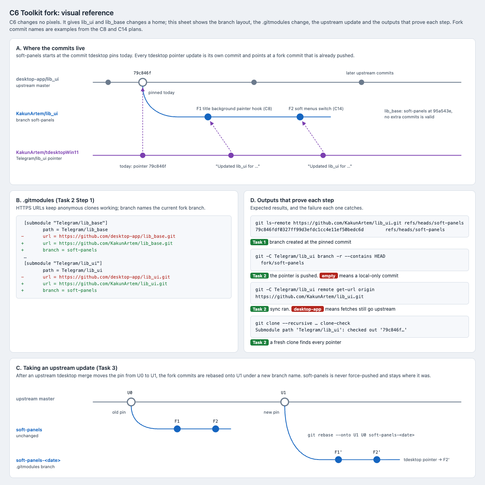

# C6 Toolkit fork: visual reference

Date: 2026-10-29. Status: proposal. Component: C6 in the
[component architecture](../../architecture.md#components). Plan:
[toolkit fork](../../plans/2026-10-29-toolkit-fork.md).

C6 changes nothing on screen. It gives the `lib_ui` and `lib_base` changes of
later plans a home. This reference draws the branch layout and the update
procedure, and lists the command outputs that prove each step.

## Files

- [Reference sheet](toolkit-fork.html): standalone and offline.
- [Screenshot](toolkit-fork.png): rendered at 100% by headless Chrome on
  macOS.

## Pinned commits on 2026-10-29

From `git ls-tree HEAD Telegram/lib_ui Telegram/lib_base` on `dev`:

| Submodule | Pinned commit | Current URL |
| --- | --- | --- |
| `Telegram/lib_ui` | `79c846fdf0327ff99d3efdc1cc4e11ef50bedc6d` | `https://github.com/desktop-app/lib_ui.git` |
| `Telegram/lib_base` | `95a543e426e35938dd632139d0bb828b268c3b4c` | `https://github.com/desktop-app/lib_base.git` |

Plan Task 1 Step 1 rereads these; if they have moved, `soft-panels` starts at
the new values, not at these.

## Panels

| Panel | Plan task | What it pins |
| --- | --- | --- |
| A. Where the commits live | Tasks 1–2 | `soft-panels` starts at the pinned commit; each tdesktop pointer update is its own commit and points at a pushed fork commit. `lib_base` may keep no extra commits. |
| B. `.gitmodules` | Task 2 Step 1 | The URL and `branch` change for both submodules. |
| C. Upstream update | Task 3 | Fork commits rebased from the old pin U0 onto the new pin U1 as `soft-panels-<date>`; `soft-panels` is never force-pushed. |
| D. Outputs | Tasks 1–2 | `ls-remote`, `branch -r --contains`, `remote get-url` and a recursive clone, each with the failure it catches. |

## Notes

- Panel C creates the dated branch before rebasing, so the local
  `soft-panels` does not move either. Task 3 rebases `soft-panels` itself and
  pushes it under the new name; both leave the remote `soft-panels` as it was.
- F1 and F2 are examples taken from the [title bar](../../plans/2026-10-29-title-bar.md)
  and [transient surfaces](../../plans/2026-10-29-transient-surfaces.md)
  plans.
- The `ls-remote` and clone outputs show the expected shape; the forks do
  not exist yet.

