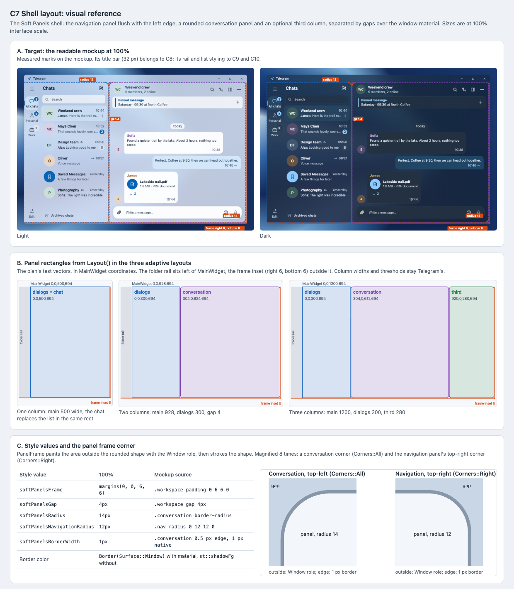

# C7 Shell layout: visual reference

Date: 2026-10-29. Status: proposal. Component: C7 in the
[component architecture](../../architecture.md#shell-geometry-c7). Plan:
[shell layout](../../plans/2026-10-29-shell-layout.md).

C7 arranges the main window as Soft Panels: a navigation panel flush with the
left edge, a rounded conversation panel and an optional third column,
separated by thin gaps over the window material. This reference marks those
sizes on the mockup, draws the panel rectangles for the plan's test cases and
magnifies the panel frame corners.

## Files

- [Reference sheet](shell-layout.html): standalone and offline; it loads the
  two screenshots below.
- [Mockup, light](mockup-light.png) and [mockup, dark](mockup-dark.png): the
  [readable mockup](../../explorations/README.md) at 100% scale over Blue
  folds, captured with `?bare=1&scale=100`.
- [Screenshot](shell-layout.png) of the sheet, rendered at 100% by headless
  Chrome on macOS, so text uses the system font rather than Segoe UI.

## Panels

| Panel | Plan task | What it pins |
| --- | --- | --- |
| A. Target | Task 3 Step 5 | On the mockup at 100%: gap 4, frame inset right 6 and bottom 6, navigation right corners 12, conversation corners 14. |
| B. Layout() | Task 1 | The three test vectors as rectangles in `MainWidget` coordinates, all at the same scale, with the folder rail to the left of `MainWidget` and the frame inset outside it. |
| C. Values and corners | Tasks 1–2 | The five style values with their mockup source; `PanelFrame` corners magnified 8 times, with the Window role outside the shape and a 1 px border on the panel edge. |

## Notes

- The mockup's navigation panel is 340 px: a 64 px rail plus a 276 px list.
  In Telegram the rail is `FiltersMenu`, outside `MainWidget`, and the list
  keeps Telegram's own width (300 in the test vectors). Only the gaps and
  the frame come from the mockup.
- The mockup has no third column; its 14 px radius and gap are this plan's
  proposal for it.
- The mockup's 0.5 px edge becomes a 1 px border natively, as the plan's
  `softPanelsBorderWidth` says.
- Rail, list, header and composer styling in the screenshots belong to C9–C12.
  Compare only geometry here.

