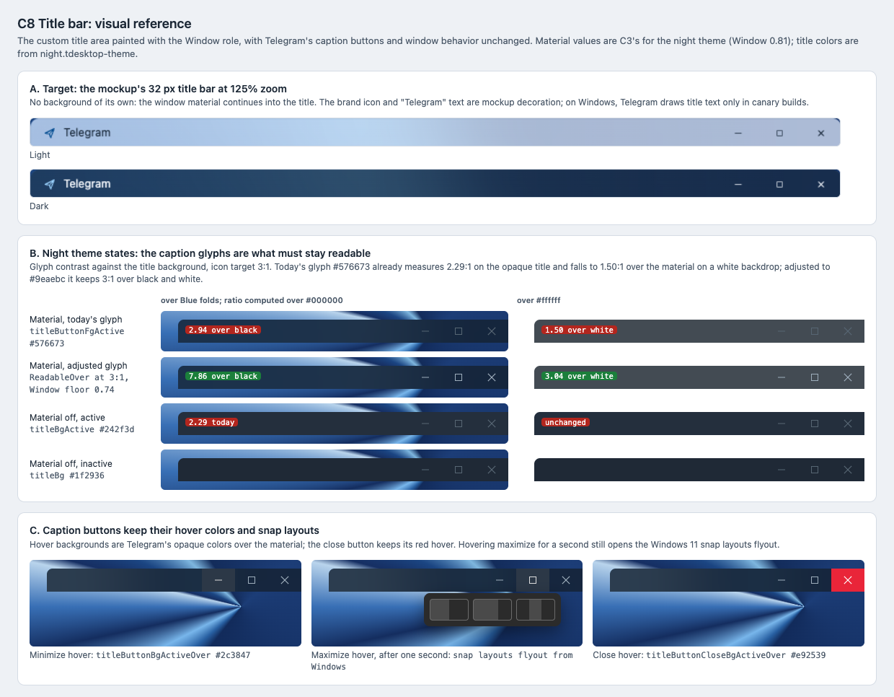

# C8 Title bar: visual reference

Date: 2026-10-29. Status: proposal. Component: C8 in the
[component architecture](../../architecture.md#components). Plan:
[title bar](../../plans/2026-10-29-title-bar.md).

C8 lets the window material continue into the custom title area, keeping
Telegram's caption buttons and window behavior. This reference shows the
mockup's title, the night theme title in each state with its glyph contrast,
and the caption button hovers.

## Files

- [Reference sheet](title-bar.html): standalone and offline; panel A crops
  the [C7 mockup screenshots](../c7-shell-layout/README.md).
- [Screenshot](title-bar.png): rendered at 100% by headless Chrome on macOS.

## Panels

| Panel | Plan task | What it pins |
| --- | --- | --- |
| A. Target | Task 2 Step 4 | The mockup's 32 px title has no background of its own; the material runs through it. |
| B. Night theme states | Task 2 Step 3, Task 3 Steps 1 and 4 | Caption glyph contrast with material (today's and adjusted glyph) and without (active, inactive). |
| C. Hovers | Task 3 Step 2 | Minimize and maximize hovers in `titleButtonBgActiveOver`, the red close hover, and the snap layouts flyout on maximize. |

## Findings from the source

Checked while making this reference. Both change the plan, which now points
here.

- **The title has no text on Windows in release builds.** `titleFg` and
  `titleFgActive` are marked "(macOS only)" in the palette. On Windows they
  are used only by `Ui::CreateTitleSubWidget` for the canary build label
  (`MainWindow::setupCanaryTitleLabel`, under `Core::BuildIsCanary`), and
  that widget fills its own background with `titleBgActive` / `titleBg`.
  What must stay readable is the caption glyphs: `titleButtonFg`,
  `titleButtonFgActive`, `titleButtonCloseFg` and `titleButtonCloseFgActive`,
  against the icon target 3:1.
- **Night theme glyphs already miss 3:1.** `#576673` on `titleBgActive`
  `#242f3d` is 2.29:1 today. Over the Window fill (0.81) it is 2.94:1 on a
  black backdrop and 1.50:1 on white. `ReadableOver` at 3:1 against the
  Window floor (0.74) gives `#9eaebc`: 7.86:1 and 3.04:1, and 5.96:1 on the
  opaque title. It was computed with the
  [C3 script](../c3-material-fills/compute-fills.py).
- **`_titleShadow` exists only with the native frame.**
  `MainWindow::refreshTitleWidget` creates it only when the native frame is
  on and `Platform::NativeTitleRequiresShadow()`, and destroys it for the
  custom title. Material is refused with the native frame (C2), so Task 2
  Step 2 has nothing to hide when material is on. It only needs to confirm
  this.

## Notes

- The mockup's brand icon and "Telegram" text are decoration; adding them
  would be a new feature, not part of C8.
- How DWM renders the Acrylic title for an inactive window comes from the C1
  matrix; the sheet does not guess it.
- Day theme title colors live in `lib_ui`'s default palette, which is not
  checked out here, so only the night theme is drawn.

