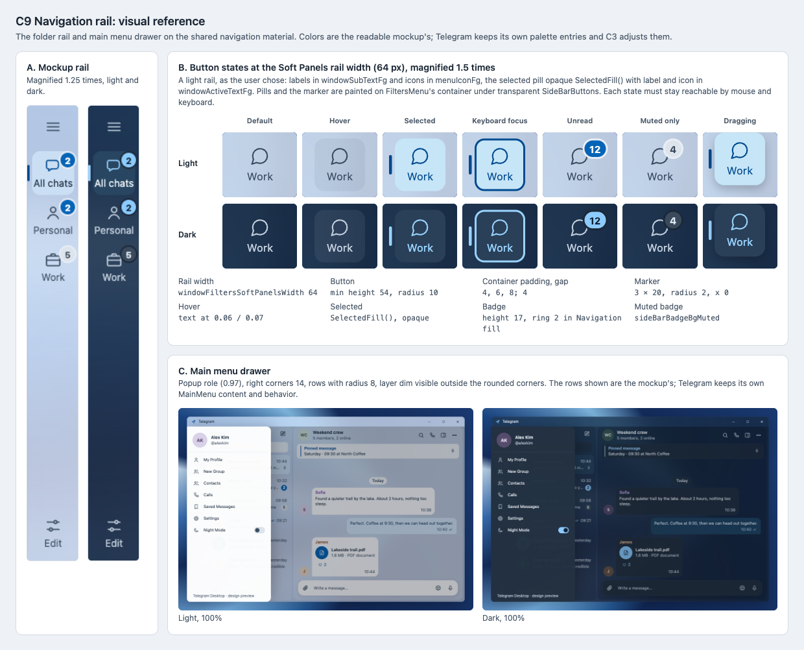

# C9 Navigation rail: visual reference

Date: 2026-10-29. Status: proposal. Component: C9 in the
[component architecture](../../architecture.md#element-styling-c9c15). Plan:
[navigation rail](../../plans/2026-10-29-navigation-rail.md).

C9 restyles the folder rail and the main menu drawer on the shared
navigation material. This reference shows the mockup's rail and drawer, and
every button state the plan lists at Telegram's own rail width.

## Files

- [Reference sheet](navigation-rail.html): standalone and offline; panel A
  crops the [C7 mockup screenshots](../c7-shell-layout/README.md).
- [Main menu, light](mockup-menu-light.png) and
  [main menu, dark](mockup-menu-dark.png): the
  [readable mockup](../../explorations/README.md) at 100% with its menu
  opened, captured from a scratch copy that clicks the menu button on load.
- [Screenshot](navigation-rail.png) of the sheet, rendered at 100% by
  headless Chrome on macOS.

## Panels

| Panel | Plan task | What it pins |
| --- | --- | --- |
| A. Mockup rail | Task 1 | Menu button, folders with icon and label, selected pill with marker, badges, Edit at the bottom. |
| B. Button states | Tasks 1–2, Task 4 States row | Default, hover, selected, keyboard focus, unread badge, muted-only badge and dragging, light and dark, at 72 px and magnified 1.5 times, with the plan's sizes listed below them. |
| C. Main menu drawer | Task 3 | Popup fill, rounded right corners, rounded rows, and the layer dim outside the corners. |

## Notes

- The mockup's rail is 64 px; Telegram keeps `windowFiltersWidth` (72 px)
  unless the user decides otherwise. Panel B uses 72 px.
- Colors are the mockup's tokens (`--selected`, `--hover`, `--accent`,
  `--muted-fill`). The app uses its palette entries (`sideBarBgActive`,
  `sideBarBadgeBgMuted` and others). In the day theme they were made for a
  dark sidebar: C18 raises the rail icons, and the labels and selected fill
  are an [open decision](../../architecture.md#open-decisions).
- The keyboard focus ring is a proposal: a 2 px accent outline on the pill.
  Telegram's current focus style for `SideBarButton` must be rechecked in
  `lib_ui`.
- The main menu's rows and account header are the mockup's. The plan changes
  only the drawer's shape, fill and row corners; `MainMenu` keeps its own
  content.
- A premium-locked folder is a state in the Task 4 States row, but it has
  no mockup design, so it is not drawn.

