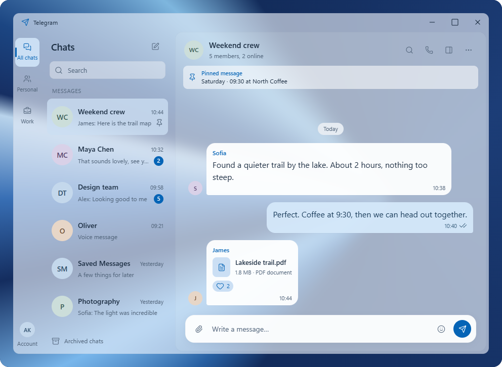
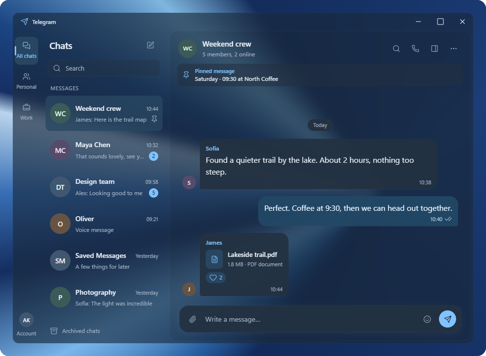

# Approved Soft Panels reference

Approved by the user on 2026-10-28 after the transparency correction. This is
the appearance baseline for the Telegram Desktop Windows 11 redesign.

## Files

- [Standalone interactive preview](soft-panels.html): open in a browser; it
  follows the system light/dark appearance and works without network access.
- [Source snapshot](soft-panels.fragment.html): the fragment used to reproduce
  the approved preview.
- [Light screenshot](soft-panels-light.png).
- [Dark screenshot](soft-panels-dark.png).
- [Lucide icon license](LUCIDE-LICENSE.txt): the standalone preview embeds the
  same pinned Lucide 1.17.0 runtime used by the approved preview.

## Approved appearance

- Soft Panels layout with a folder rail, contact list and inset conversation.
- Thin, low-contrast edges and a narrow outer frame.
- Desktop backdrop visible through the window, contacts and conversation.
- Denser message and composer fills, with full-strength text and icons.
- Rounded message bubbles, grouped pinned content and a floating composer.

The backdrop is an independent layer behind the window. Changing it must
change the appearance of both panels; a gradient painted inside an opaque
window is not the approved transparency effect.

This approval concerns the visual result. Browser blur and opacity values are
reference values, not validated native Windows or Qt implementation choices.
Preview interactions use example content and do not send real messages.

Keep this approved snapshot stable while exploring subsequent element states.

## Light appearance

## Dark appearance

